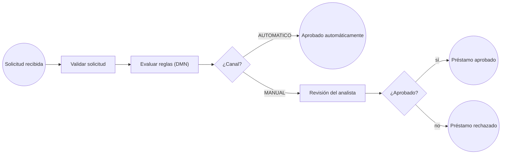

# Loan Approval BPM

Orquestación de aprobación de préstamos con **BPMN 2.0** y **DMN**, sobre Spring Boot 4 y Flowable 8.

Un préstamo se valida, pasa por una tabla de decisión que define si se aprueba automáticamente o va a revisión, y en ese caso queda esperando en la bandeja de un analista, persistido en PostgreSQL, hasta que alguien lo aprueba o lo rechaza.

## Proceso



Modelo: [`loan-approval.bpmn20.xml`](src/main/resources/processes/loan-approval.bpmn20.xml)

### Reglas de decisión

Tabla [`aprobacion-automatica.dmn`](src/main/resources/dmn/aprobacion-automatica.dmn), hit policy `FIRST`:

| Monto       | Canal        |
|-------------|--------------|
| ≤ 500.000   | `AUTOMATICO` |
| > 500.000   | `MANUAL`     |

Las reglas viven fuera del código Java: cambiar el umbral es cambiar la tabla, no el delegate.

## Stack

- Java 21, Spring Boot 4.1
- Flowable 8 (motores BPMN y DMN embebidos)
- PostgreSQL 18 con Docker Compose
- JUnit 5 + Testcontainers

## Cómo correrlo

Requisitos: JDK 21 y Docker.

```bash
./mvnw spring-boot:run
```

Spring Boot levanta PostgreSQL automáticamente desde `compose.yaml`.

```bash
./mvnw test
```

Los tests de integración usan un PostgreSQL efímero con Testcontainers.

## API

```bash
# Crear solicitud
curl -X POST localhost:8080/loans -H "Content-Type: application/json" \
     -d '{"solicitante":"Ana Gomez","monto":2000000}'

# Bandeja del analista
curl localhost:8080/tasks

# Aprobar o rechazar
curl -X POST localhost:8080/tasks/{taskId}/decision -H "Content-Type: application/json" \
     -d '{"aprobado":true}'

# Estado del préstamo
curl localhost:8080/loans/{loanId}
```

Estados posibles: `EN_REVISION`, `APROBADO_AUTOMATICO`, `APROBADO`, `RECHAZADO`.

## Decisiones de diseño

- **Límite transaccional en el wait state.** Las service tasks síncronas corren en la misma transacción que el inicio del proceso. Si la validación falla, se hace rollback completo y no queda ninguna instancia huérfana; hay un test que lo verifica.
- **Una sola fuente de verdad.** El estado del préstamo se deriva del historial del motor (en qué end event terminó), no se duplica en una tabla propia.
- **Business key.** El `loanId` es un identificador de negocio independiente del id interno de la instancia.
- **Versionado de procesos.** Al desplegar un modelo nuevo, las instancias en curso siguen en la versión con la que arrancaron.
- **Tareas por grupo.** La revisión se asigna al grupo `analistas` (candidate group), no a una persona.
- **Montos en `BigDecimal`** y la JVM en UTC.

## Roadmap

- [ ] Timer de SLA: escalar la revisión si nadie la toma en N horas
- [ ] Integración REST con un core bancario simulado, con boundary error event y reintentos
- [ ] Agente de IA (servicio Python) para análisis de riesgo, con revisión humana cuando el agente marca riesgo
- [ ] CI con GitHub Actions
- [ ] Deploy en OpenShift